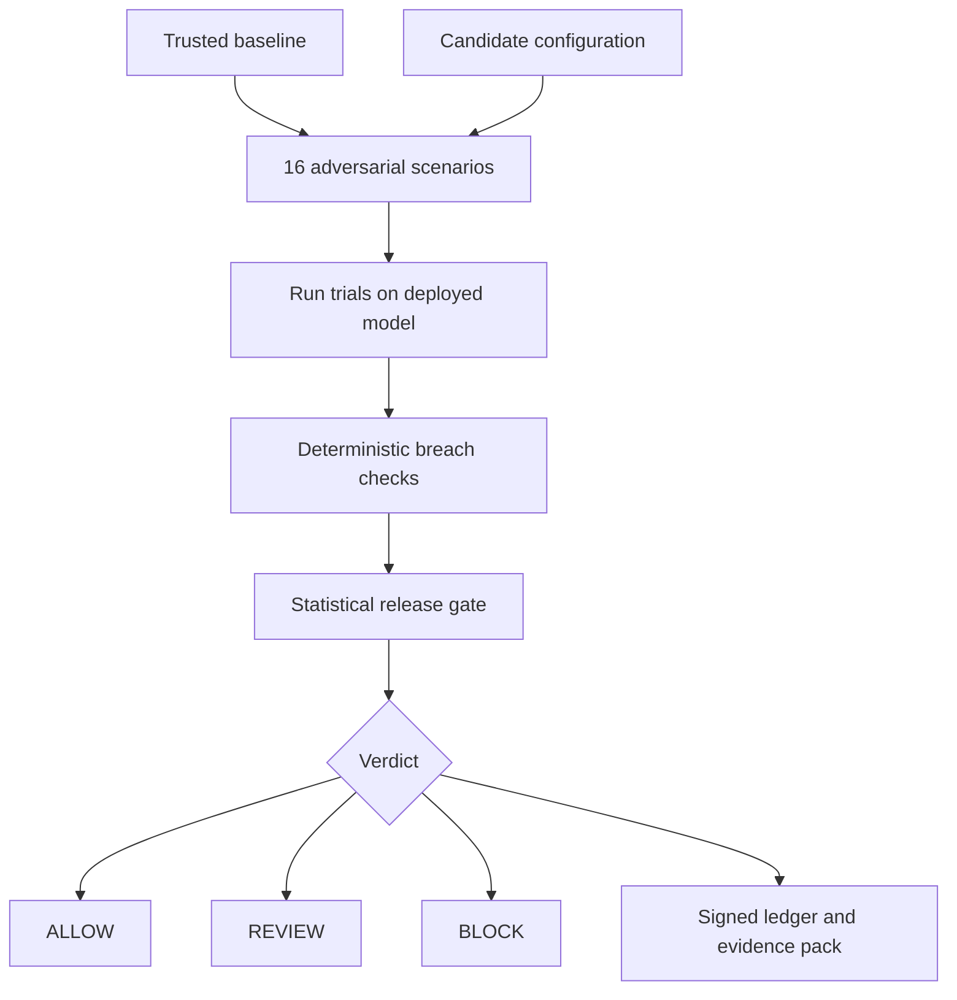

<!-- GitHub Profile README | github.com/hadi-ce04 -->

  

  
  
  

    

  

  
<b>Computer Engineering @ Epitech Paris</b> 🇫🇷

  
Curious about systems that can <b>perceive, decide and act</b>.

  <a href="#agentgate">AgentGate</a> &nbsp;•&nbsp;
  <a href="#projects">Projects</a> &nbsp;•&nbsp;
  <a href="#toolbox">Toolbox</a> &nbsp;•&nbsp;
  <a href="#activity">Activity</a>

---

## 🛡️ Featured Project · AgentGate

**A release gate that tests AI agents for security regressions before a configuration change ships.**

Developed as a **team hackathon project** at Secure Horizons. Instead of assuming a prompt or tool change is safe, AgentGate runs adversarial tests against a trusted baseline and a candidate, measures the difference, and records the release decision.

  
  
  
  

 

| What it tackles | How |
| :-- | :-- |
| **Prompt injection & tool misuse** | Tests malicious instructions planted across user turns, email, documents and tool descriptions. |
| **Uncertain safety claims** | Uses deterministic breach checks and Wilson confidence intervals instead of asking an LLM to grade itself. |
| **Hard-to-audit deployments** | Produces signed, tamper-evident decision records and exportable evidence packs. |
| **Finding the risky edit** | Isolates configuration changes to identify regressions and interactions. |

**Built with:** `Python` · `Amazon Bedrock` · `Streamlit` · `Cryptography` · `Statistical Testing` · `AI Agent Evaluation`

  
  

<b>🔎 Open the AgentGate architecture</b>

 

AgentGate also supports change attribution, signed human overrides, and scheduled rechecks. The project uses synthetic test data, and the gate evaluates configured attack scenarios rather than guaranteeing complete security.

---

## 👨‍💻 A Little About Me

I'm a **Computer Engineering student** who likes building things that connect software to the real world. I'm especially drawn to the boundary between intelligent software, physical systems and reliable infrastructure.

I enjoy the full cycle: **idea → experiment → working prototype → improvement**. That might mean testing an AI agent, streaming telemetry from simulated machines, or getting an object detector running on camera input.

**What I'm focused on:**

- 🤖 **Robotics:** autonomous systems, ROS2 and robot perception
- 🧠 **AI:** computer vision, LLM-powered agents and evaluation
- ⚙️ **Automation:** practical workflows, tooling and system integration
- 🌐 **Software:** full-stack apps and real-time architectures
- 🔌 **Embedded:** connecting code, sensors and hardware

---

## 🚀 Other Projects

<table>
  <tr>
    <td width="50%" valign="top">
      <h3>📚 <a href="https://github.com/hadi-ce04/studysync">StudySync</a></h3>
      
<b>Study together. Stay focused.</b>

      
A collaborative study application with real-time study rooms, Pomodoro sessions, tasks, shared music and AI-assisted learning.

      
<code>React</code> <code>TypeScript</code> <code>FastAPI</code> <code>WebSockets</code> <code>Tailwind</code>

      
      
    </td>
    <td width="50%" valign="top">
      <h3>⚡ <a href="https://github.com/hadi-ce04/sentinelgrid">SentinelGrid</a></h3>
      
<b>Real-time visibility into simulated machines.</b>

      
An industrial fleet simulator and monitoring dashboard with live machine telemetry, anomaly detection, fault injection and incident alerts.

      
<code>Python</code> <code>FastAPI</code> <code>WebSockets</code> <code>JavaScript</code>

      
    </td>
  </tr>
  <tr>
    <td colspan="2" valign="top">
      <h3>👁️ <a href="https://github.com/hadi-ce04/robot-vision-yolo">Robot Vision YOLO</a></h3>
      
<b>Giving camera-equipped systems a way to understand their surroundings.</b>

      
A real-time object-detection experiment using YOLO and OpenCV, exploring the perception layer for future robotics applications.

      
<code>Python</code> <code>YOLO</code> <code>OpenCV</code> <code>Computer Vision</code>

      
    </td>
  </tr>
</table>

---

## 🧰 Toolbox

**Languages & web**

**Backend, tools & infrastructure**

**AI, robotics & automation**

<b>📍 What I'm exploring right now</b>

- **Robotics:** ROS2, simulation pipelines, control and robot perception
- **AI:** agent evaluation, adversarial testing and computer vision
- **Systems:** real-time communication, streaming telemetry and embedded interfaces
- **Automation:** Python, Docker, n8n and repeatable developer workflows

---

## 📈 GitHub Activity

  

---

## 🤝 Let's Build Something

I enjoy **hackathons, open-source experiments and collaborating with people who like turning ideas into real working systems**. If you're working on something involving agents, robotics, intelligent automation or real-time software, I'd love to hear about it.

  
  
Discord: <code>hadi__x4__93060</code>

  

