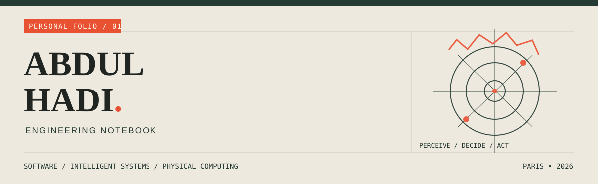
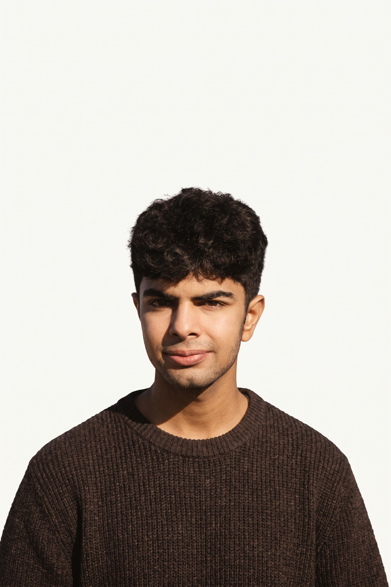
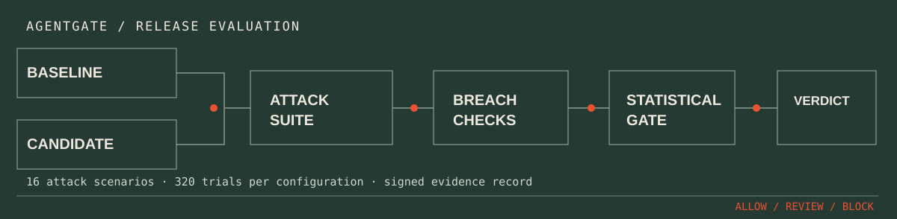

<!-- PROFILE REPOSITORY: github.com/hadi-ce04/hadi-ce04 -->
<!-- EDITORIAL SYSTEM: paper / ink / vermilion / forest -->

  

<table>
<tr>
<td width="67%" valign="top">

### Building systems that leave the screen.

Computer Engineering student currently studying at **EPITECH Paris**. I work across intelligent software, computer vision, automation and real-time systems.

I like the entire process: asking the question, making a prototype, testing its assumptions, and figuring out where it breaks.

**Currently exploring:** agent evaluation, robot perception, reliable automation and the boundaries between software and hardware.

[Selected work ↓](#02--selected-work) &nbsp;·&nbsp; [How I build ↓](#03--the-method) &nbsp;·&nbsp; [Get in touch ↓](#05--contact)

</td>
<td width="33%" valign="top">

</td>
</tr>
</table>

---

01 / FEATURED STUDY

# AgentGate.

**An evidence-driven release gate for changes to AI agent configurations.**

[Source code](https://github.com/hadi-ce04/agentgate) &nbsp; / &nbsp; [Sample evidence pack](https://github.com/hadi-ce04/agentgate/blob/main/evidence/samples/pack_v7_llama.pdf)

Created with a team at the **Secure Horizons hackathon**. The question was simple: *when an agent's prompts, tools or configuration change, how do we know whether the new version is less safe?*

Rather than asking another model for a subjective safety score, AgentGate compares a trusted baseline with a candidate using adversarial scenarios, deterministic breach checks and a statistical release gate.

| The engineering problem | The approach |
| :--- | :--- |
| Prompt injection and tool misuse | Test malicious instructions across user input, documents, messages and tool descriptions. |
| Uncertain claims about safety | Apply deterministic checks and Wilson confidence intervals to observed outcomes. |
| Changes that are hard to audit | Record decisions in signed, tamper-evident evidence packs. |
| Regressions with unclear causes | Isolate edits and investigate their effect on test outcomes. |

`Python` `Amazon Bedrock` `Streamlit` `Cryptography` `Statistical evaluation`

TEST CONFIGURATION DOCUMENTED IN THE PROJECT: 16 ADVERSARIAL SCENARIOS / 320 TRIALS PER CONFIGURATION / ALLOW · REVIEW · BLOCK

<b>What this project taught me</b>

 
Security decisions need observable evidence and explicit assumptions. A statistical gate can detect regressions in the scenarios it tests, but it cannot prove an agent is universally safe. The project uses synthetic test data and makes that scope explicit.

---

02 / SELECTED WORK

# A few things I've built.

### 001 &nbsp; StudySync

**A shared workspace for focused study.** Real-time study rooms, Pomodoro sessions, task tracking, shared music and AI-assisted learning. The interesting engineering challenge is making collaborative state feel immediate and coherent across clients.

`React` `TypeScript` `FastAPI` `WebSockets` `Tailwind`

[Repository](https://github.com/hadi-ce04/studysync) &nbsp; ↗ &nbsp; [Live application](https://studysync-henna-delta.vercel.app)

---

### 002 &nbsp; SentinelGrid

**A simulated industrial fleet you can observe and disrupt.** Live machine telemetry, anomaly detection, fault injection and incident alerts. A study in streaming state, observability and how interfaces communicate failure.

`Python` `FastAPI` `WebSockets` `JavaScript`

[Repository](https://github.com/hadi-ce04/sentinelgrid)

---

### 003 &nbsp; Robot Vision YOLO

**Experiments in machine perception.** Real-time object detection using YOLO and OpenCV, exploring the perception layer that a camera-equipped robotic system needs before it can react to the world.

`Python` `YOLO` `OpenCV` `Computer Vision`

[Repository](https://github.com/hadi-ce04/robot-vision-yolo)

---

03 / THE METHOD

# Observe. Prototype. Test. Refine.

I don't see projects as finished screenshots. I'm interested in what changes between the first working version and the version that can survive real use.

**01 / Observe** &nbsp; Understand the problem, the users and the constraints.

**02 / Prototype** &nbsp; Build the smallest real system that can challenge an assumption.

**03 / Test** &nbsp; Measure behavior, reproduce failure and question easy conclusions.

**04 / Refine** &nbsp; Improve the architecture, the interface and the documentation.

---

04 / WORKING MATERIALS

# My toolbox, in context.

| Area | Tools and techniques |
| :--- | :--- |
| **Languages & interfaces** | Python, C++, JavaScript, TypeScript, React |
| **Services & infrastructure** | FastAPI, WebSockets, Docker, Linux, Git |
| **Intelligent systems** | YOLO, OpenCV, Amazon Bedrock, LLM agents |
| **Robotics & physical computing** | ROS2, Arduino, Raspberry Pi |
| **Automation** | Python workflows, n8n, system integrations |

These are tools I use or explore, not a claim of equal expertise in all of them.

---

05 / CONTACT

# Have an interesting problem?

I enjoy hackathons, engineering experiments and working with people who care about turning ideas into something testable.

**GitHub** &nbsp; [@hadi-ce04](https://github.com/hadi-ce04)  
**Discord** &nbsp; `hadi__x4__93060`  
**StudySync** &nbsp; [Open the live app](https://studysync-henna-delta.vercel.app)

---

ABDUL HADI &nbsp; / &nbsp; ENGINEERING NOTEBOOK &nbsp; / &nbsp; BUILT TO BE READ, NOT SCROLLED PAST.
